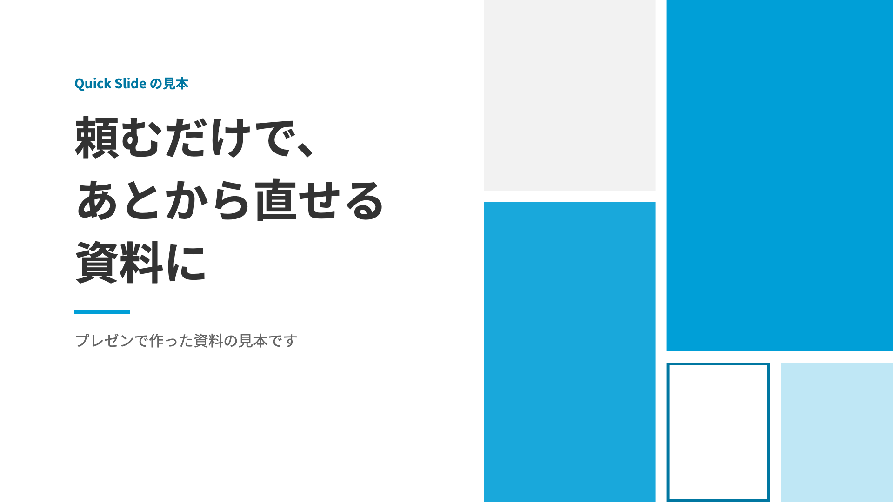

# Quick Slide

**会話をスライドに。その場で直して、持ち出せる。**

Codex・Claude に「この内容をスライドにして」と頼むと、ブラウザで見られる資料を作ります。
ページを指定して直し、PPTX・PDF に書き出せます。macOS・Windows 向けのローカルプラグインです。



| 形式 | できること | 見本 |
|---|---|---|
| プレゼン | 文字・図形をあとから編集できる PPTX。PDF にも書き出せる | [プレゼンの見本](samples/presentation/script.json) |
| ピッチ | ページ全体を画像で描く。PPTX・PDF に書き出せる | 下の画像 |
| モーション | クリックで図が動く Web プレゼン。HTML で持ち出せる | [モーションの見本](samples/motion/built/run/index.html) |


## はじめる

### 1. プラグインを追加する

配布元は GitHub のリポジトリ `mrkm86/quick-slide` です。
会話にまとめて依頼したい方は、[初回導入プロンプト](docs/FIRST-INSTALL.md) を Codex または Claude Code に貼ってください。
プラグイン未導入でも使える依頼文です。

**ChatGPT デスクトップ（Codex）**

Codex の会話に次の文を貼ります。

> GitHub の mrkm86/quick-slide を Quick Slide のプラグインとして登録・インストールしてください。
> 既存のプラグイン設定を保持し、終わったら次にする操作を教えてください。

登録するコマンドは以下です（ターミナルで実行する場合も同じ）。

```text
codex plugin marketplace add mrkm86/quick-slide
codex plugin add quick-slide@quick-slide
```

`plugin add` がない版では、マーケットプレイス登録後に ChatGPT を再起動し、
Plugins Directory のソース「Quick Slide」から追加してください。追加後は新しい会話で使います。
[公式のプラグイン導入手順](https://developers.openai.com/plugins/build/plugins)

**Claude デスクトップ・Claude Code**

Claude Code の会話で次を実行します。

```text
/plugin marketplace add mrkm86/quick-slide
/plugin install quick-slide@quick-slide
```

Claude デスクトップでは、Customize → Plugins → Add → Add marketplace →
Add from a repository に `https://github.com/mrkm86/quick-slide` を入れ、Quick Slide を追加することもできます。
[公式のプラグイン導入手順](https://support.claude.com/en/articles/13837440-use-plugins-in-claude)

手元のフォルダから試す方法は [導入・検証ガイド](docs/INSTALL.md#手元のフォルダから入れる) にあります。

Quick Slide は手元のファイルとコマンドを使います。Claude ではローカル実行のできる
Claude Code で使ってください。Cowork での利用は、実行環境からホスト側の CLI と
ローカルサーバに届くかを確認する必要があります。通常のチャットへの追加だけでは動作を保証しません。

### 2. 準備を依頼する

インストール後、新しい会話で次のように頼みます。

> Quick Slide を使えるようにセットアップして。必要なものを確認し、
> 管理者権限なしで入れられるものを入れてください。ログインが必要なら案内して。
> 最後にサーバを起動して、見本を開いてください。

セットアップスキルが診断し、入れられる依存ソフトを導入します。
初回はブラウザなど数百 MB のダウンロードがあり、数分かかります。
**アカウントへのログインと、アプリの再起動は利用者が行います。**

| 必要なもの | 準備のしかた |
|---|---|
| Python 3.12 以上 | 未導入なら python.org から導入。Windows は `py -3` で実行 |
| Node.js 18 以上 | 未導入なら nodejs.org から導入 |
| Codex CLI と ChatGPT のログイン | `npm install -g @openai/codex`、続いて `codex login` |
| 台本を書く CLI | Codex または Claude Code のどちらかにログイン。自動設定では、会話元の CLI がなければもう一方を使う |
| Python のパッケージ・描画用ブラウザ | セットアップスキルが導入。モーション用の Playwright も診断 |
| プレゼン用の字体 | Windows は OS の游ゴシック。macOS は PowerPoint 付属の游ゴシック、または字体設定 |

絵を描くのは **ChatGPT のサブスクにログインした Codex CLI** です。
Claude から使う場合も、絵には Codex のログインが必要です。API キーは不要です。

Codex のサンドボックスからサーバを起動できない場合は、提示されるコマンドを
利用者のターミナルで一度実行します。プラグインのインストールだけで依存ソフトやログインが揃うわけではありません。

### 3. 作る・直す・書き出す

> この会話を、提案用のスライドにして。まず構成を見せて。

> 3枚目の見出しを短くして。

作成した画面の URL が会話に返ります。アプリの内蔵ブラウザが利用できればそこで開き、
届かなければ外部ブラウザ、最後に URL を手で開く順に案内します。
内蔵ブラウザでの localhost 接続はアプリの版・実行環境によるため、必ず実機で確認してください。

ホームの「資料を作成する」では、テーマ・形式・ブランドなどを選び、会話に貼る依頼文をコピーできます。
この画面ではスライドは作成されません。Quick Slide を導入した Codex・Claude Code の会話に貼り付けて送信してください。
調査や事実確認は会話で行い、原稿をQuick Slideへ渡して資料に仕上げます。
ページ構成を確認してから作るか、そのまま作成まで進めるかも選べます。
コピーしたときの選択条件はQuick Slideのconfigに記憶します。テーマ本文は保存しません。
既存のPowerPointは、ホームの「プレゼン資料を取り込む」から取り込めます。

書き出しは画面右上の PPTX・PDF ボタンから。モーションは HTML を書き出します。
初回起動では3形式の見本が入ります。見本は削除してもよく、設定から入れ直せます。

## 更新する

新しいバージョンが公開されると、ホームの画面の頭にお知らせが出る（変更点は GitHub のリリースの頁、更新のしかたは 設定 › 更新）。
変更の記録は [`CHANGELOG.md`](CHANGELOG.md)。

更新は、次のどれかでする。

1. **会話で頼む**（おすすめ）: Claude Code か Codex に「**Quick Slide を更新して**」と伝える。スキルが新しいバージョンと変更点を見せ、
   よいか聞いてから、使っているアプリのコマンドで更新する（`skills/quick-slide/scripts/quick_slide_update.py`）
2. **コマンドを会話に貼る**: 下のコマンドを、Claude Code か Codex の会話にそのまま貼り付ける
3. **ターミナルで実行する**: 下のコマンドを自分で実行する

```text
# Claude Code（そのあと /reload-plugins か、新しい会話）
claude plugin marketplace update quick-slide
claude plugin update quick-slide@quick-slide

# Codex（そのあと Codex を起動し直す）
codex plugin marketplace upgrade quick-slide
codex plugin add quick-slide@quick-slide
```

動いている Quick Slide のサーバは止めなくてよい。次に使ったとき、新しいバージョンの入口が古いバージョンのサーバを起こし直す
（処理中の作業があれば終わってから）。Codex から使うときは、ターミナルで `--start-server` をもう一度流す。

新しいバージョンがあるかは、サーバが GitHub（`api.github.com`）の最新のリリースを 6 時間に 1 回まで問い合わせて確かめる。送るのは
問い合わせと、いま使っているバージョンの番号だけ。止めるには 設定 › 更新 の切り替えか、環境変数 `QUICK_SLIDE_NO_UPDATE_CHECK=1`。


手元のフォルダから入れた場合の更新は [更新手順](docs/INSTALL.md#更新する) を参照してください。

## Windows にも入れる

Windows 機でも同じ配布元からプラグインを追加し、その機械の会話で上のセットアップを依頼します。
macOS 側のログインや依存ソフトは移りません。Python の呼び方は `python3` ではなく **`py -3`** です。
OneDrive の同期先や長すぎるパスを避けると導入が安定します。診断もこれらを確認します。

実機での確認項目と、手動セットアップは [導入・検証ガイド](docs/INSTALL.md) を参照してください。
Windows での既存の開発テストと、デスクトップアプリからのプラグイン導入・内蔵ブラウザの通し確認は別に扱います。

## 詳しい使い方・開発

- [会話から使うスキル](skills/quick-slide/SKILL.md)
- [同梱の見本と再生成](samples/README.md)
- [導入・検証ガイド](docs/INSTALL.md)
- [作業ルールとテスト](AGENTS.md)

データや描画用の道具はプラグインの外に保存します。置き場は `places.py` が決め、
`QUICK_SLIDE_HOME` で変更できます。プラグインの更新とスライドの保存は独立しています。

## 同梱している第三者のソフトウェア

- [**yomiyasu**](https://github.com/nanaism/yomiyasu)（日本語の文章のリンター・MIT）— 台本係が書いた台本の検査に使う。写しとライセンス文（`LICENSE`・`UNICODE-LICENSE.txt`）、版と更新の手順は
  [`src/quick_slide/vendor/yomiyasu/`](src/quick_slide/vendor/yomiyasu/README.md)

- デザイン素材・アイコン — 出典、加工の表記とライセンスは [素材の説明](skills/dads/README.md#出典加工の表記とライセンス) を参照してください。

## 利用条件

Quick Slide はソースを公開するソフトウェアですが、OSSではありません。
**個人の非商用利用を許可します。商用・業務利用、本体の改変・派生物作成・再配布・販売は、
権利者の事前の書面による許可が必要です。** 通常のインストール・更新・バックアップのための複製は許可します。

業務利用は、社内での利用や個人の端末での利用も含みます。個別に許可された方は、その許可の範囲で利用できます。
設定画面での設定変更、自分の原稿・画像・ロゴの入力、生成したスライドの編集は本体改変に含めません。
業務利用の許可だけでは、本体の改変・再配布・販売は許可されません。
詳細は [利用許諾条件](LICENSE) を参照してください。許可の申請は配布元リポジトリの管理者へお願いします。
同梱する第三者の著作物は、それぞれのライセンスに従います。

### 生成した資料・画像について

**生成した資料を公開・配布・提出する前に、素材や生成画像の権利・利用条件、内容の正確性を
利用者自身で確認し、必要な許可を取得してください。** Quick Slide は成果物の適法性、正確性、
第三者の権利を侵害しないことを保証しません。

画像生成には Codex を利用します。生成画像には、生成元を示す来歴情報（C2PA）や、
目には見えない電子透かし（SynthID）が含まれる場合があります。
これらは異なる仕組みです。[OpenAI の公式説明](https://developers.openai.com/api/docs/guides/content-provenance)

Quick Slide は、各画像への付与状況や、編集・PPTX・PDF 等への書き出し後の保持・検出を保証しません。
提出先・公開先の AI 生成物に関するルールや表示の要否も、利用者自身で確認してください。
