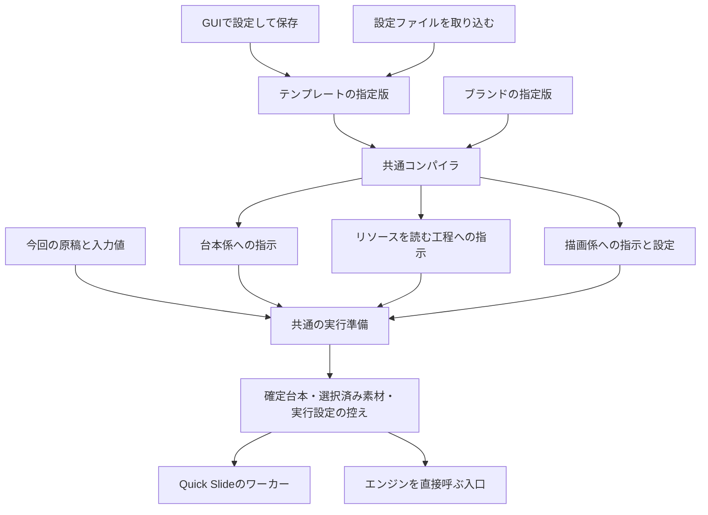

# デザインテンプレート: GUI・保存・台本・描画の共通契約

状態: 設計と、本番の保存・API・設定画面・会話 CLI（PR 1〜4）。試作（`tools/preview_settings.py`・`web/app/settings-preview.*`・その試験）は、本番の設定画面ができた時点でリポジトリから外した（配布物に入れないため）。以下の試作への言及は経緯として残す。#22 の対象。通常の投入・生成ワーカーへの接続は未実装。
従来の `issue-22-input-design.md` の入力・GUI に関する検討は、この文書で具体化する。
ブランド詳細は既存の画面を使い、その下にテンプレートの一覧・追加・編集だけを足す。
ブループリントは #27、Motion は #28。

## 0. スライドスタイルとの関係

設定の「スライドスタイル」は画面をやめている（`docs/adr/0009-no-style-settings-screen.md`）。API・DB・`--style-id` は、
前に作ったスタイルで描いたデッキを描き続けるための互換としてだけ残っている。ADR 0009 は「いつもの自分の作風」を
言葉の束として保存して使い回す仕組みを後で考えるとしており、デザインテンプレートがその役目を担う。
テンプレートはスライドスタイルを参照せず、新しく `--style-id` に依存する入口も作らない。

## 1. 共通化する単位

GUI、設定ファイル取り込み、会話からの登録は、同じ版付きのテンプレート文書を作る。
台本の指示と描画の指示を、それぞれの入口で別々に要約・翻訳し直さない。



「同じ結果」は、同じモード・テンプレート版・ブランド版・原稿・確定台本・選択済み素材を使い、
同じエンジンの指示・引数・検査を使うこと。画像生成の画素単位の一致は保証しない。
別々の LLM 呼び出しで台本を書き直した場合も、台本が一致したとは扱わない。
比較には確定した1つの台本と素材の控えを使う。

## 2. GUI と保存項目の対応

利用者が設定するのは4項目だけ。細かい欄（目的・読者・描画の細目・毎回の入力・確認基準・届け先の選択）は置かない。
エンドユーザーには多すぎて使いこなせず、届け先（台本係か描画係か）の区別もつけにくいため。
書き分けたい場合は、追加指示の中に見出しを立てて書けばよい。

| GUI のタブ | 保存項目 | 台本・描画への渡し先 |
|---|---|---|
| 基本 | `name`・`description`・`modes`（`brand_id` はシステムが入れる） | 検索・選択・モード検査 |
| 構成 | `structure`（文字列） | Markdown・YAML・自由文でページ順・役割・追加条件を記入。解析・要約せず台本係へ原文を渡す |
| 追加指示 | `instructions`（文字列） | 届け先を選ばせない。台本係・素材準備・描画係の全員へ同じ原文を渡す |
| リソース | `resources[]` の `name/kind/path/usage`、`attachments[]` の `name/usage` と取り込んだファイル | 名前と置き場の対応表として、全員へ同じものを渡す |

ID、改訂、ハッシュ、添付の URL などはシステムが作る。保存形式（`schema_version` 3）には画面の4項目以外を持たせない。
別途注入した「対応表」や「概要」に設定上の効力を持たせない。

構成は固定8枚などに限定せず、「独立した主張があるときだけ追加する」のような条件を文章で持つ。
承認済みの台本が渡された場合は、その枚数・順序が構成より優先する（コンパイラが常にそう書く。利用者の選択項目にはしない）。

今回ごとに渡す情報（開催日・原稿など）の項目定義は持たない。必要なら追加指示に
「開催日が渡されていなければ作成前に確認する」と書く。

## 3. リソースは名前・ファイルかフォルダ・パスで登録する

| 項目 | 内容 |
|---|---|
| 名前 | 追加指示や構成から、この名前で呼ぶ。パスの付いたリソースと添付ファイルを通して重複させない |
| 種類 | フォルダ／ファイル |
| パス | このパソコン上の絶対パス、または `~/` から始まるパス |
| 使い方（任意） | 追加指示にまとめて書いてもよい |

ファイルも種類「ファイル」のリソースとしてパスで指定する。画面に「ファイルを添付」は置かない（パスの指定と役目が重なり、利用者に区別がつかないため）。前の画面で取り込んだ添付（`attachments[]`）は、名前・使い方の編集と削除だけできる形で残す。

画像集などのフォルダは、中身を全件登録させない。フォルダを1件のリソースとして登録し、
中の説明書き（`SKILL.md`・`README.md`・`README.txt` の順で最初に見つかったもの）を先に読んでから、
必要なファイルだけを選ぶ。説明書きを持つフォルダなら、そこに書かれた使い方（どの絵がどの場面向けか等）に
サーバや GUI が意味を焼き込まなくても従える。

指示の中の名前とリソースをつなぐため、コンパイラは全員への指示に次の対応表を付ける。

```markdown
# リソース
追加指示や構成に出てくる名前は、次の登録リソースを指す。名前から別の素材を推測しない。
フォルダの場合は、中の説明書き（SKILL.md・README.md・README.txt）があれば先に読み、使い方に従って必要なファイルだけを選ぶ。
指示で使うリソースが見つからない・読めない場合は止めて確認し、代わりの素材を作らない。

## 画像集
- 種類: フォルダ
- パス: <ローカルのフォルダ>
- 使い方: 内容に合う絵を選ぶ
```

登録したリソースは、どれも見つからなければ素材準備へ進めない（任意・必須の切り替えは置かない。
「なくてもよい」場合は使い方にそう書く）。

読み取り先があるだけでは、「読んだ」「適切な絵を選んだ」にはならない。
現在の台本係は Claude の道具を無効にし、プロンプトでもファイルを読ませないため、
パスをそのまま台本係へ貼るだけの実装にはしない。

共通の実行準備を次の段に分ける。

1. **入口の確認**: 登録したパスが読めるか。読めなければ停止。
2. **リソースの読解**: 素材準備の担当が、フォルダの説明書きと、追加指示・使い方を読む。
   利用可能な絵や語彙はそこで取得する。GUI やサーバに個々の絵の意味を焼き込まない。
3. **台本作成**: 原稿・追加指示・リソースから得た一覧を台本係に渡す。台本係は、ページと必要な素材を指定する。
   原稿に明示がある場合は、その指定を守る。
4. **素材の解決**: 読解した使い方に従って必要なファイルだけを取得し、ページと結ぶ。
   既定の絵へ黙って落とす・全ページに出す・代わりの人物を生成するなどを許可なく行わない。
5. **控えと検査**: 選んだファイル・説明書きのハッシュ・ページとの対応・選択理由を控える。
   追加指示について「満たした／確認できない」を返し、確認できない条件を満たしたことにしない。

素材準備で行うのは読み取りと利用素材の選択。説明書きが別の手順（生成・投稿・記録更新など）を
書いていても、それは実行しない。CLI での読み取りが必要なフォルダは、登録した読み取りアダプタで呼ぶ。
任意のコマンドをそのまま実行する入口にはしない。適したアダプタがなければ未対応として止める。
リソースが別フォルダの画像を正当に指す場合は、その依存先も読んだ場所・選択した画像として記録する。

参照画像の上限はフォルダの全件数に適用しない。**各ページに実際に渡す画像**を、枠・構図の手本・キャラクター・
全ページ共通参照を含めて、エンジンと同じ順序・同じ上限で検査する。

## 4. 保存から共通指示を作る

`design_templates.validate` が入力を確かめ、`compile_document` が保存した文書とブランドから以下を生成する。

| ファイル | 用途 |
|---|---|
| `template.json`・`brand.json` | 解釈の元になった文書の控え |
| `writer.md` | 原稿とは別の、台本係が従う要件 |
| `preparation.md` | リソースを読み、必要な素材を選ぶ要件 |
| `style.yaml` | image-slide の既存のカスタムスタイル形式 |
| `theme.yaml` | ブランドから生成した既存エンジン形式のテーマ |
| `engine-input.json` | ロゴ・フッター・ページ番号・字体など、エンジンの実行設定の元 |
| `compilation.json` | コンパイラ版・テンプレート版・契約ハッシュ・未実行の工程 |

自由文を400字などへ切り詰めず、LLM の自動要約を挟まない。
`instructions_compiled` は指示を組み立てただけの状態。`render_ready=false` を明示し、
未解決のリソースを含む ZIP を「そのまま描ける資料」と表示しない。
試作のパス存在確認と `preparation.md` は、素材準備の実行実装の代わりではない。

## 5. 本番での接続点

以下は設計であり、今回の試作ではまだ接続していない。

- **保存**: `design_templates` と `design_template_revisions` を追加する。ブランド ID と対応モードを持つ。
  改訂は不変とし、同時編集は期待した改訂 ID の一致で検査する。画面・ファイル取り込みとも同じ検査を通す。
- **投入**: `store/intakes.py` でテンプレート改訂と今回の入力値を受ける。ブランドを一致させ、
  対応モードを確認する。投入内容の同一判定にもテンプレート版・原稿・入力値を含める。
  会話・CLI からは `--design-template <名前または ID>` と `--design-template-version <版>` で指定する。
  **版を省略したら最新の版**を使う。名前はブランドの中で探し、同じ名前が複数あれば ID での指定を求める。
  どの版も保存した控えから呼び出せる（試作の `…/compiled?revision=N` と同じく、版の番号で引く）。
- **設定解決**: `render/look.py` がブランド版・テンプレート版・今回の明示指定から実効設定を1回だけ作る。
  データ・キャッシュの置き場は既存のパス管理を通す。試作の外部フォルダを本番の置き場には使わない。
- **台本**: `writer/prompt.py` の初稿・修正・差し込みへ、共通の `writer.md` と素材準備の結果を渡す。
  現在の `_characters` 一律禁止は、準備済み参照を持つページだけ緩める。
- **台本の検査**: `writer/patch.py` で参照 ID と適用範囲を検査する。指定の省略と明示的な削除を区別する。
  パッチで言及のない参照は引き継ぎ、明示的な空配列で消す。ページを分割した場合は、各ページの指定を求める。
- **描画**: `engines.py` の check/deck/revise が、同じ実効設定と参照ファイルを使う。
  `engine.json` 作成時に、準備済みの参照を既存エンジンの画像パス・`_characters`・`_layout` 等へ変換する。
  image-slide の実際のオプション・台本の形は変えない。
- **直しと版**: 元の回のテンプレート版・ブランド版・素材ハッシュを継承する。テンプレート更新だけで既存資料を変えない。
  版は上書き保存できるので、資料を作るときに使ったテンプレートの中身を資料の側に写して残す（実行準備の控え）。
  あとで同じ版が上書きされても、その資料の直しは控えた中身で行う。
  新版へ移る操作は明示する。版に戻すときの既存成果物の再利用と、旧条件による再生成は区別する。

優先順位は、エンジンの契約を守った上で、今回明示された原稿・指示、選んだテンプレートの指示、既定値の順。
ブランドの色・ロゴは共通データとして渡し、テンプレートは使い方を指示する。
同じ優先度の条件が衝突する、未対応の指示が必須になっている場合は、黙って捨てずに説明して停止する。

## 6. エンジンを直接使う場合

image-slide は台本 JSON と描画設定を受けるエンジンであり、原稿からの台本作成は呼ぶ側の担当。
そのため `--style` だけを共通にしても、Quick Slide と同じ入力にはならない。

共通の実行準備を CLI からも使える入口を用意する設計とする。サーバは同じ関数を呼び、
直接実行もその入口を通す。ここで別のテンプレート解釈や台本要約をしない。

```text
今回の入力 + 共通指示
  → リソースの読解 → 台本作成 → 必要な素材の解決 → 検査
  → prepared-run/
       manifest.json       # mode / compiler / revisions / hashes / 実効オプション / 遵守状況
       engine.json         # 確定台本
       settings/           # style.yaml / theme.yaml / ロゴ / 実行可能な字体設定
       assets/             # 今回選んだ画像だけ
       reference-records/  # 読んだ説明書き・ハッシュ・選択理由・ページ対応
  → 同じエンジン呼び出し
```

直接用とサーバ用の入口は、この控えから共通の command builder で引数を作る。
作業先の違いだけを正規化すれば、台本・素材・スタイル・テーマ・フッター・ロゴ等と実効引数が一致する。
元のフォルダが更新されても、実行準備後の再開や比較では控えた画像を使う。
テンプレートの指示 ZIP は、この `prepared-run` とは別。

HTML には image-slide の `style.yaml`・`_characters` がそのまま効かない。
構成・追加指示・リソースは台本係へ渡せる。追加指示に画像スライド向けの書き方（画風など）が含まれる場合、
HTML の表現にできる範囲で反映する。HTML 用の素材配置・挿絵の生成への対応付けは本番接続の範囲。
「同じ結果」の比較は、HTML と IMAGE を同じ見た目にする意味ではなく、同じモード内での経路の一致である。

## 7. 会話・CLI からの登録と更新

スキルに書いてある週報・月報・会議などの作り方を、利用者が画面で手入力しなくてよいようにする。
Claude Code・Codex が会話の中で呼ぶ CLI を、会話用スキルの横に置く（未実装・設計）。保存は画面と同じ検証・同じ版の扱いを通し、
画面と CLI で結果がずれないようにする。

```text
quick_slide_template.py list   [--brand 名前または ID]
quick_slide_template.py show   --template 名前または ID [--version N]      # 省けば最新
quick_slide_template.py export --template 名前または ID [--version N] --out <ファイル>
quick_slide_template.py add    --brand 名前または ID --from <ファイル>      # 新しく登録（v1）
quick_slide_template.py update --template 名前または ID --from <ファイル> [--overwrite] [--dry-run]
quick_slide_template.py copy   --template 名前または ID [--name 新しい名前]   # 複製（別のテンプレートとして v1 から）
quick_slide_template.py delete --template 名前または ID                     # 削除（一覧から外す。版の控えは残す）
```

- **渡すファイル**は、画面の4項目そのままの Markdown 1枚。前付け（YAML）に名前・説明・使える形式・リソースを、本文に
  `# 構成` と `# 追加指示` を書く。版・由来は書かせない。ID は書き出したファイルに入るが、取り込みで「同じテンプレートか」を照合するためだけに使い、新しく作るときは常にサーバが ID を付ける。
- **名前での指定**は、ブランドの中で探す。同じ名前が複数あれば ID を求める。
- **更新の既定は新しい版**。`--overwrite` を付けたときだけ最新の版を上書きする。AI が書き換えた内容を確かめずに使っても、
  前の版に戻れるようにするため（画面の「保存は上書き」と逆なのは、人が手で直すのと AI に頼むのとで安全な側が違うため）。
- **版を増やしすぎない**:
  - 最新の版と中身が同じなら版を作らず、「変更なし」と返す。
  - 同じ会話の中での直しは、その会話で作った版を上書きする（会話の識別子は投入と同じものを使う）。
    別の会話や画面から直すときは新しい版にする。
  - 結果に「v5 を作りました（変更：構成・追加指示）」のように、変わったタブを返す。会話側はそれをそのまま利用者に伝える。
- **CLI は対話しない**（エージェントからは確認の画面を出せない）。会話用スキルの説明に、「上書きか新しい版か、どのテンプレートか、
  意図が読めないときは実行する前に利用者に聞き返す」と書く。`--dry-run` で、何が起きるか（新しい版か上書きか・変わるタブ）を
  先に確かめられるようにする。
- **ChatGPT など手元の CLI を呼べない画面**からは、同じ形式のファイルを作ってもらい、設定の画面の取り込みで登録する
  （ブランドの書き出し・取り込みと同じ形にそろえる。未実装）。

### 複製と削除

- **複製**は、別のテンプレート（新しい ID、名前に「のコピー」）として v1 から始める。元の版の履歴は引き継がない。
- **削除**はブランドと同じく、消さずに一覧から外す（`deleted_at` の印）。版の控えは残し、そのテンプレートで作った資料は
  作ったときの中身を控えているので、直しも描き直しもできる。「無効にする」状態は設けない（使わないものは選ばなければよく、
  状態を増やすと一覧と CLI の扱いが1段複雑になる）。画面に「元に戻す」は置かない（ブランドと同じ）。
- 画面では、ブランド詳細のテンプレート一覧の各行に「編集」と ⋮ を置き、⋮ に「複製」「削除」を並べる。

### 書き出し・取り込み（ADR 0004 に沿う）

試作では、テンプレート1つの書き出し・取り込み（Markdown の読み書きは `design_templates.to_markdown`・`from_markdown`）まで動く。
ブランドの ZIP に含めるところは未実装。

テンプレートの受け渡しの形は、CLI に渡すファイルと同じ **Markdown 1枚**（前付けに名前・説明・使える形式・リソース、本文に構成と追加指示）にそろえる。
CLI・ChatGPT から作ったファイル・画面の書き出し・ブランドの ZIP の中身が、すべて同じ形になる。

- **テンプレート1つの書き出し**: `qs-テンプレート-<名前>.md`。版は最新（または指定した版）だけで、履歴は入れない。
  ファイル名は人が見分けるためだけに付け、読み込むときは中の形式名（前付けの `format: quick-slide-template`）で見分ける。
- **ブランドの書き出し**: ブランドの ZIP（`format: quick-slide-brand`）の形式の版を 2 に上げ、`templates/<ID>.md` として
  そのブランドのテンプレート（削除したものを除く、最新の版）を入れる。書き出すときに「デザインテンプレートも含める」を選べる（既定は含める）。
  版 1 の ZIP もそのまま読める。
- **取り込み**はブランドと同じ 2 段（確かめる → 保存する）。同じ ID のテンプレートがあれば「新しい版として取り込む／別のテンプレートとして追加／やめる」、
  無ければそのブランドに v1 として作る。黙って上書きしない。テンプレート1つを取り込むときは、入れる先のブランドを選ぶ。
- **リソースのパスは、そのパソコンの中の場所**。別のパソコンに取り込むと見つからないことが多いので、取り込みの確かめで
  「このパソコンで見つからないリソースが 2 件あります」と出し、取り込んだあとはカードに「見つかりません」と出す。パスは各自で直す。
- **書き出すファイルにはパスがそのまま入る**（利用者名などを含むことがある）。これは仕様とし、書き出す前の確認は出さない。

## 8. 今回動かす範囲と検証

- GUI で基本・構成・追加指示・リソースを編集できる。保存形式もこの4項目だけ。
- 保存はローカルの検証用フォルダへ行い、改訂を残す。再読み込みで復元する。
- 保存後にサーバ側の共通コンパイラを呼び、実際に生成した指示を「保存した指示を確認する（検証用）」に表示する。
  これは開発の確かめ用で、普段の画面には出さず、URL に `?debug` を付けたときだけ出す。
- 同じ保存版から指示 ZIP を書き出し、再コンパイル時の契約ハッシュ・文書の一致を確かめる。
- リソースが見つかっても「素材選択済み」としない。見つからない場合は素材準備へ進めないことを表示する。
- 本番ワーカー接続と素材準備の実行、台本の生成と実描画は後続。今回の確認結果と混同しない。

既存の会議スキルからの実データと対応の検分は、リポジトリ外のローカル検証用データで行う。
会議名・人名・私有の画像集のパスや画像をコード・テスト・公開文書へ書かない。

### 編集画面の区切り

基本・構成・追加指示・リソースの4タブに分け、選択した1つだけ表示する。スマホではタブを横スクロールでき、
前後の項目ボタンでも移動できる。切り替えは画面遷移にせず、未保存の入力を保持する。保存は全タブを対象とする。

構成は1つの文章欄とし、ページ単位のフォームは置かない。プレースホルダーと開閉式の記入例は案内だけで、
未入力なら保存・送信しない。書式の強制や Markdown の再解析は行わない。

編集画面の見出しの下に、注意を1か所だけ置く（アプリの情報用の囲み `.notice--info` で包む。黄・赤の警告にはしない）:
「AI はここに書いた指示を、いつも守れるとは限りません。できあがった資料で、指示どおりになっているか確かめてください。」
本番では、テンプレートを使って資料ができあがった画面にも、確かめを促す一文を出す（実際に確かめるのはその時点のため）。

見出しは各タブに1つだけ置き、欄の説明は短い一文か「？」のヘルプに畳む。構成・追加指示・リソースは、
見出しの右上の「？」アイコン（書き方の例）で例を出す。文章の例はコピーすると畳む。リソースの追加は、スライドの「＋ページを追加」と同じ部品で一覧の最後に置く。文章の欄はコピーして貼り、リソースは「この例を追加」で名前・種類・使い方の入った行を足す
（パスは各自で選ぶ）。リソースの各行は、普段は名前・種類・パスの末尾・使い方の頭2行だけの畳んだカードで見せ、鉛筆でその行だけ開いて編集する（足したばかりの行と、保存時のエラーで飛ぶときは開く。開閉は保存しない）。リソースの並び順に意味はないので、入れ替えの操作は置かない。削除は控えめな赤のゴミ箱アイコンにする。

リソースのパスは、種類の横の「選ぶ…」で OS のダイアログから指定できる。ブラウザのファイル選択ではフルパスが取れないため、
サーバを動かしているパソコンでダイアログを開く（試作は macOS だけ。別のパソコンのブラウザから開いている場合は、
サーバ側の画面にダイアログが出る点を本番で扱う）。
「同じパソコンからの要求か」は接続元のアドレスで見分ける（転送ヘッダは信用しない）。同じパソコンの中継（リバースプロキシ）を通す構成では見分けられないので、その構成ではダイアログを使わない。

構成と追加指示は、中身があれば Markdown を描いた状態で見せ、鉛筆アイコンで書く状態にする（空なら最初から書く状態）。
描くのは見出し・箇条書き・番号付きの箇条書き・表・太字・記号囲み（`…`）・段落だけで、HTML としては解釈しない。表はスマホでは枠の中で横にずらして読む（画面全体ははみ出させない）。Markdown で書かれていなくても
崩れないよう、1つの改行はそのまま改行として描く。AI へは描いた見た目ではなく、書かれた文字をそのまま渡す。
書き方の例には「「##」で見出し、「-」で箇条書きにできます。分けて書くと、読み返しやすく、AI にも伝わりやすくなります。」と添える。

### 版

ページの版と同じく、見出しに「v4」の札を出す。押すと「版の一覧」が開き、版ごとに保存日時・元にした版・前の版から変わったタブ・中身
（リソースは種類・パス・使い方まで）を見られる。

- **保存は今の版の上書き**。少し直して保存を繰り返しても版は増えない（増えると「もともと何からやっていたか」が辿れなくなるため）。
- **新しい版は保存ボタンの ▾ から作る**。「保存する」の右の ▾ に「v4 を上書き保存」「v5 として保存（新しい版）」を並べ、
  後者を選んだときに初めて v5 ができる（版の一覧まで行かなくても作れるように、保存の操作のそばに置く）。
- **由来を残す**。新しい版は元にした版の番号（`based_on`）を持ち、一覧に「v5（v4 から）」と出す。
- **前の版からも新しい版を作れる**。版の一覧で前の版（v2）を選ぶと、中身の上に「コピーして v5 を作成」を出す。
  押すと v2 の中身が編集画面に入り、札は点線の「v5 作成中」、保存ボタンは「v5 として保存」になる（この間は上書きを選ばせない）。
  保存すると「v5（v2 から）」ができ、v2 も最新の v4 も変わらない。
- **前の版そのものは書き換えない**。上書きできるのは最新の版だけ。
- **戻す**。未保存の変更があるときだけ、保存ボタンの左に「戻す」（一周する矢印＋文字）を出す。確認のうえ、
  保存していない編集を取り消して今の版の保存済みの内容に戻す（1手戻すのではない）。前の版をコピーして作っている間は、
  v5 の作成をやめて最新の版に戻る操作を兼ねる。
- 上書きでは版の番号が変わらないので、別の画面での更新は保存した文書の指紋（ハッシュ）で見分ける。

### 旧形式からの移行

v1（構成を行で持つ）・v2（細かい欄を持つ）の保存文書は、読み込み時に v3 へ一方向に移す。既存の保存版ファイルは書き換えない。

- 構成の行 → 役割・指示・条件を保持した Markdown の構成
- 原稿の構成を保持する設定（構成があるとき）→ 「承認済みの原稿のページ数・順番を保つ」旨を追加指示へ
- 目的・読者・描画の細目・確認基準・毎回の入力 → 見出し付きで追加指示へ（同じ文が台本と描画の両方にあれば1回だけ）
- 画風・描画範囲の設定 → 既定と異なる場合だけ、追加指示に一文で残す
- 参照先 → リソース（スキル指定はフォルダとして扱う。届け先が台本だけ・描画だけだったもの、任意だったものは、その旨を使い方に一文で足す）
- 個別素材 → 添付ファイル（届け先は同じく使い方へ）
- 形の崩れた旧文書は入力エラーとして扱い、黙って空にしない

コンパイラ版は4とする。
